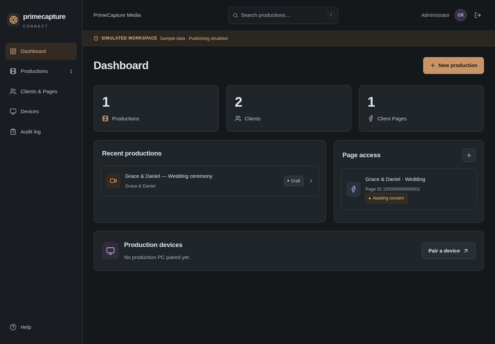

# PrimeCapture Connect

A private production workspace for PrimeCapture Media. One Next.js application, Supabase Auth/Postgres, and a small outbound-polling Node helper. Built from the supplied [PRD](docs/PRD.md).

**Delivered:** Phase 0 foundations and Phase 1 dashboard, plus status-only device pairing and a tested, isolated OBS safety kernel. **Not enabled:** real Meta OAuth/publishing/business access requests, profile publishing, cloud OBS configure/start/restore. This is a deployable foundation, not an approved Facebook production integration.

## Interface

Larger text, dark charcoal surfaces, and a spacious workspace for productions, Page access and devices. The app fills the window without an outer frame. These previews show labelled local sample data.



[View the phone layout](docs/ui/mobile.png)

## Run locally

Requires Node **24 LTS** and npm (pinned dependency tree in `package-lock.json`). Use the existing checkout; cloud tasks are already isolated and do not require a Git worktree.

```sh
npm ci
npm run dev:demo
```

Open the app in your local browser and select **Enter local simulation**. No credentials are needed. The `SIMULATED WORKSPACE` banner is always visible; records are process-local sample data, reset on server restart. The simulation never grants real Page publishing access. It is prohibited under `NODE_ENV=production`.

Working features: clients and numeric Page references, production drafts/preflight, administrator audit history, manual handoff guide, admin/operator authorization, pair/revoke devices and observe their OBS heartbeat. Save client and Page references before creating a production. A Page reference is not authorization. The app does not claim to send Facebook notifications.

## Supabase-backed workspace

1. Create a Supabase project; apply `supabase/migrations/202610280001_initial.sql` in its SQL editor (one-time migration). The SQL requires Supabase's `auth.users`, `auth.uid()`, `anon`, `authenticated`, and `service_role`, which already exist there.
2. Disable public signup in Supabase Auth. Create each staff user with **Auth → Users → Add user**; do not expose an invitation/admin key to the browser. Record the user's UUID.
3. In the SQL editor, insert its allowlist profile, substituting actual values:
   ```sql
   insert into public.staff_profiles(user_id,email,role)
   values ('STAFF_AUTH_UUID', 'crew@your-domain.example', 'admin');
   ```
   Email must be lowercase. Use `operator` for production crew; only admins pair/revoke devices, disconnect Pages and view audit events. Set `is_active=false` to remove workspace access. Supabase users alone are insufficient for authorization.
4. Copy `.env.example` to `.env.local`. Set `APP_BASE_URL`, `SUPABASE_URL`, `SUPABASE_ANON_KEY`, `SUPABASE_SERVICE_ROLE_KEY`. Leave simulation/Meta flags off. Generate `TOKEN_ENCRYPTION_KEY` with a local secret manager or `node -e "console.log(require('crypto').randomBytes(32).toString('hex'))"`; save privately, never commit the output. Encryption is tested but production Meta-token storage is not yet wired to a real integration.
5. Set Auth's Site URL to the verified origin and allowlist `<APP_BASE_URL>/auth/callback`. Configure Supabase SMTP for production delivery. Sign-in uses server-side PKCE email links with `shouldCreateUser:false`, an active staff allowlist, and a non-enumerating response. Require staff MFA through your organization's Supabase identity policy; this release does not implement an in-app MFA enrollment screen.
6. Run `npm run dev` and sign in using the staff email. Schema failures fail closed. Browser access to credentials/device tokens is prohibited; all writes pass server role/origin checks and transactional database functions.

Supabase-hosted login/email delivery has **not** been exercised here because no project/credentials were supplied. The actual SQL migration, RLS and transactional pairing are tested using embedded PostgreSQL, with a minimal Supabase Auth schema fixture.

## Sign-in button and local configuration

Cloud environment secrets do not transfer to a cloned GitHub repository. For the real staff login on your computer, copy `.env.example` to `.env.local` beside `package.json` and privately fill in `SUPABASE_URL`, `SUPABASE_ANON_KEY` and `SUPABASE_SERVICE_ROLE_KEY`. On Windows, check that the filename is exactly `.env.local`, not `.env.local.txt`. Set `APP_BASE_URL` to the local app origin and keep the demo flags false. Stop the running server with Ctrl+C, run `npm run dev`, then reload the sign-in page.

If setup is incomplete, the development sign-in page lists the missing variable names and provides a local setup checklist. The button stays available after the page loads; submitting shows the server's setup error instead of silently remaining disabled. Production shows an administrator-facing setup message without listing server configuration details. Missing settings never allow authentication or access to protected routes. The initial “Loading sign-in…” state requires JavaScript; enable it if the page never becomes interactive.

## Checks

```sh
npm run lint
npm run typecheck
npm test
npm run build
npx playwright install --with-deps chromium
npm run test:e2e
```

`npm test` includes encryption, input/CSRF/auth/roles, API behavior, PostgreSQL RLS/pairing/rate limits, OBS guard tests and a real WebSocket-protocol simulator using `obs-websocket-js`. It opens loopback test ports (including 4455); close any real OBS test instance first. It does **not** contact Meta, send video, stop streams or assert a real Windows OBS rehearsal passed. Test workspaces use labelled fake data only.

If Chromium is preinstalled, set `PLAYWRIGHT_CHROMIUM_EXECUTABLE_PATH` to its executable instead of downloading it. In this cloud image: `PLAYWRIGHT_CHROMIUM_EXECUTABLE_PATH=/usr/bin/chromium npm run test:e2e`. Browser tests start their own labelled simulation with all real Supabase keys excluded. Close any server on port 3000 before running the suite; the tests do not reuse an existing workspace server.

Build/dev use Next's supported Webpack mode because this cloud's process sandbox blocks Turbopack's CSS compiler IPC socket. No TLS, integrity, or signature verification is disabled.

## Production build and deployment

```sh
npm ci
npm run build
npm start
```

Deploy this root as a Next.js project on Vercel with Node 24. Configure the real Supabase variables and HTTPS `APP_BASE_URL` in Vercel's server environment. **Do not set `DEMO_MODE=true` or `MOCK_META_ENABLED=true` in production.** No secrets have a `NEXT_PUBLIC_` prefix. There are no remote fonts, browser Supabase credentials, or required external media assets. Set Vercel's production domain and Supabase redirect allowlist consistently. Apply migrations before directing staff to the deployment. `/api/health` returns only a generic status, not integration readiness.

The optimized build can succeed without credentials, but staff login and persistence require the configured Supabase project. Saving cloud setup instructions does not deploy to Vercel, apply migrations, or publish an environment snapshot.

## Release gates and next steps

See [Meta feasibility](docs/meta-feasibility.md), [Windows helper setup](agent/README.md), [operations](docs/operations.md), [security model](docs/threat-model.md), and [validation evidence](docs/validation.md). The supplied build instructions are archived as reference in `docs/CODEX_START_HERE.md`.

Real Page OAuth and publishing require human-owned Meta app credentials, current approved scopes/features, app review evidence, a consenting test Page, and an actual end-to-end test. Cloud OBS control additionally requires a real authenticated Windows OBS rehearsal, command delivery/claim/result integration and recovery testing. Flags alone cannot unlock those unimplemented paths. The app deliberately returns a blocked response instead of inventing a successful connection.

Source repository: https://github.com/JoshuaUdenyi/primecapture_connect. No live production resources have been created.

To run a local copy with Node 24 LTS installed:

```sh
git clone https://github.com/JoshuaUdenyi/primecapture_connect.git
cd primecapture_connect
npm ci
npm run dev:demo
```

Open the address printed in your terminal and choose **Enter local simulation**.
